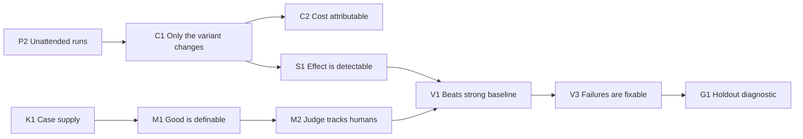

# Riskiest assumptions

Status: register v2, 2026-10-19. Companion to [WORKFLOW-EVALS-STRATEGY.md](WORKFLOW-EVALS-STRATEGY.md). Sources: [EVIDENCE-BASE.md](EVIDENCE-BASE.md).

Twenty assumptions. Ids P2, C1, C2, M1, M2, S1, E1, V1, V2, V3, G1, M3, D1, D2, G2, G3 and P1 are unchanged. K1, M4 and D3 are new. Rows below were revised before any test, against the 2026-10-19 review. After the first test of a row, do not edit its text; further revisions are new Ids.

The order is a qualitative ranking: gating assumptions first, then higher stakes per unit of test cost. Impact, uncertainty and cost are **not** numerically scored. There is no computed risk column.

Numbers in the tests are planning defaults, not statistical guarantees. An A/A run does not replace the §7 detectable-effect table. Cost in this register means run counts and human minutes. Prices are not estimated here.

## Categories

The categories follow the chain an eval result depends on. Each assumption belongs to exactly one.

| Code | Category | The question it protects |
|---|---|---|
| P | Platform fit | Can OMP and Tern run and show the experiments at all? |
| C | Control and observability | Do we know exactly what ran and what it cost? |
| K | Case supply | Can one person author and audit the pinned case set? |
| M | Measurement validity | Does the score mean what we think? |
| S | Statistical sensitivity | Can we detect the differences we care about with affordable N? |
| E | Economics | Can we afford the eval cadence in money, time and attention? |
| V | Value | Is there something real to gain from workflow design? |
| G | Generalisation | Do gains transfer beyond the cases we tuned on? |
| D | Durability | Do the lab and its findings survive OMP, model and grader updates? |

## Proving order

K1 gates Phase 1 authoring and does not wait on P2. P2, C1 and C2 gate every paid comparison. M1 and M2 gate any judge-backed claim. S1 gates a claim that the design can see the effect. V1 is the first value test. G1 is a diagnostic beside the L3 rule, not a second promotion rule. D3's anchor set is frozen in Phase 1, when the judge exists. M3, M4, D1, D2, the D3 re-grade and G2 are Phase 4. G3 and P1 are Phase 5. P1's notes start at the Phase 2 review; the decision is Phase 5. D1, D2 and D3 also fire on the next update, whenever it comes.

## Register

| Id | Assumption | Why risky | Cheapest credible test | Pass | Kill / decision if false | Phase |
|---|---|---|---|---|---|---|
| P2 | OMP print mode can run a skill-defined variant unattended, on a trial directory outside any repo, with artifacts in `out/` and the named skill actually loaded | All execution depends on it. A skill that never loads is a baseline trial. `--no-skills` is not the baseline | Smoke: baseline (`--tools read,write,edit,grep,glob`, no `task`, no domain skill) and one skill variant (skill named in the entry prompt) on two synthetic cases. Lab `--profile`, `--approval-mode` not `always-ask`, `--max-time`, `--session-dir` per trial | 4/4 finish without interaction; artifacts present; skill arm records skill loaded yes (2/2) | Record a platform gap. Do not scrape `tern capture` or switch to RPC to force a pass. If subagents cannot run headless, record that before any multi-agent experiment | 0 |
| C1 | The variant is the only change between arms. Global profile, ancestor `AGENTS.md`, `.omp/rules`, extensions and model defaults do not leak. The observed model per role matches the requested role map | Profiles isolate auth, sessions, settings and caches, not the work tree. One "observed model" misses a delegated Haiku seat | Canary on the corporate Claude-only profile (primary target) and any lab profile used to imitate it. Marker rule and marker skill in the global profile; marker in an ancestor `AGENTS.md`; marker in `.omp/rules`. Each marker demands a visible token. Trial directory outside any repo | 10/10 trials show no marker token. Observed model, thinking level and context cap match the requested role map on every seat that ran | Comparisons stay L0–L1 until the profile is clean. Fix the boundary. Do not parse internals to explain a leak away | 0 |
| C2 | Per-trial usage, including subagents, can be attributed without parsing event streams, and `omp stats` does not mix in other profiles | `omp stats` is aggregate and has no session or profile filter. Cost is a first-class metric | After the P2 smoke, reconcile the export, an allow-list read of model, provider and usage from the session file (missing becomes unknown, never an error), and `omp stats` deltas. Trials are serial. No other OMP activity on that profile. The test includes that stats moved only with the trial | Totals agree within a stated tolerance, or the unknown parts are bounded, and stats respected the profile | Report cost at experiment grain via profile-isolated stats. Mark per-trial cost unknown. Do not parse event streams | 0 |
| K1 | One person can author and audit the Phase 1 case set at ≤ 45 minutes per case (lab choice, not a cited standard) | Case writing is the binding constraint. Three parallel domains recreate the over-build problem as process | Time the first 4 case cards (author plus audit) for text-only proposal storylines in the existing brief format | Median ≤ 45 minutes, and 12 dev + 8 holdout, split by cluster, is completable. Labels live at `labels/<criterion>@<rubric>.jsonl` | Narrow the job class until those counts fit. Do not open a second domain. Do not drop the holdout to save time | 1 |
| M1 | "Good" can be written down precisely enough that independent grading agrees | Proposals are judgment-heavy. κ on an imbalanced set can look poor when agreement is high, and a self-blind is not a second rater | Open-code ≥ 30 dev outputs. At most 5 binary criteria. Double-label with a second rater when one exists. Report raw agreement, positive and negative agreement (or Gwet's AC1), and κ. A week-later self-label is consistency only | Where both classes have ≥ 20 items, positive and negative agreement ≥ 0.8. κ is reported and is not the sole drop rule | Rewrite, split, or drop the criterion. If most criteria fail, the job class is underspecified. A solo self-blind does not pass this row | 1 |
| M2 | A judge pinned to a role on the corporate map can stand in for the user on the surviving criteria | Tiny held-out sets pass weak judges by chance. Labels from one arm, or from the holdout, bias the paired difference. There is no second provider to use as judge | Labels from dev cases only, every arm, seeded failures marked. Train/dev/test. Test split touched once per frozen prompt. Judge is slow seat or default. One criterion per call. Unknown allowed. Report per-arm TPR/TNR with counts and Wilson 95% intervals, plus swap consistency. Re-calibrate when variant outputs change | Per arm, on the test split: ≥ 20 pass and ≥ 20 fail, point TPR and TNR ≥ 0.8, Wilson lower bound ≥ 0.6, swap consistency ≥ 90% | That criterion stays human-graded or becomes a T0 check. Cut criteria until the label set fits the time budget (feeds E1). Do not add a GPT judge | 1 |
| S1 | At the planned n, the pre-registered effect is detectable on the same suite, metric and graders as V1 | An A/A ω² is zero by construction, so it cannot set the threshold. A 15-point effect needs about 39 cases at ω² = 1/9 and zero trial noise. An underpowered "tie" must not kill V1 | A/A on the Phase 1 proposal suite (not a separate mini-suite) to estimate trial noise only. MDE from a pre-registered ω² in [1/9, 1/4] or a dev pilot, using the strategy §7 table at n = 10/20/40 | The detectable effect at the planned n is at or below the pre-registered minimum effect worth acting on | If that effect is still undetectable at n = 40 under the assumed ω², restrict claims to L1 or change the metric. Inconclusive is not "matches" | 1 |
| E1 | A comparison experiment's model usage and human grading fit a written budget. The one-time calibration set is larger than an hour and is not this bar | A lab that is skipped reverts to vibes. Pretending calibration fits in an hour cuts labels below the M2 minimums | Measure during S1 and M1: runs, reported usage, wall time, and human minutes per comparison. Record calibration minutes separately | Budget per experiment written down and met. Comparison grading within the user's stated tolerance | Shrink criteria, slow the cadence, or use a judge that has already passed M2. Never drop the baseline. Case-authoring time is K1, not this row | 1 |
| V1 | For text-only proposal storylines, workflow structure beats a strong single agent given the same information, tools list (except `task`), role map and budget | Core bet. Multi-agent wins on breadth-heavy research and loses on coherent artefacts; tokens explain much of the variance | Pre-registered paired comparison on the Phase 1 domain, dev then one holdout look. Cost columns. Matched-budget arm where feasible. Same role map | L2 on dev (interval excludes zero), then L3 on holdout, guardrails non-inferior, cost acceptable | If B is worse, or B sits inside the equivalence margin at higher cost, keep the simpler arm. Inconclusive is not a kill and not a promotion | 2 |
| V2 | Spending more (best-of-n with a verifier, critique loops, a stronger orchestrator) raises quality on at least one pre-registered step | "Push as hard as possible" assumes more compute converts. Three noisy points cannot show a knee | Sweep 1×, 2× and 4× budget on dev. Plot quality vs reported cost. Do not fit a knee | At least one step's quality rise has an interval that excludes zero | No step excludes zero: invest in briefs and source packs rather than inference spend. That is "no detected rise", not a proven plateau | 3 |
| V3 | Failures cluster into a small number of fixable causes; skill edits reduce them without breaking other cases | If fixes are whack-a-mole, the loop only measures | Three loop cycles on dev transcripts. Regression suite each cycle. Holdout only as aggregates under the one-look budget | Top failure bins shrink and the regression suite holds | Pivot to structural changes (inputs, tools, gates) or accept the variant as near ceiling for this role map | 3 |
| G1 | Dev gains are not an artefact of the dev set. The promotion rule is L3, not a magnitude ratio | Tuning on dev overfits. Two promotion rules will be applied inconsistently | Every promotion uses one confirmatory holdout look. Report the decision and aggregates only. Record the dev-vs-holdout magnitude ratio beside the decision | L3: holdout interval excludes zero in the same direction as dev. The "half the dev magnitude" ratio is reported and is not required | Wrong-direction holdout (interval excludes zero against the dev sign): freeze tuning and refresh dev. An interval that covers zero is inconclusive, not a failed transfer and not a promotion | 3 |
| M3 | Per-output eval scores move with real acceptance and edit minutes | One variant has one mean score, so there is nothing to correlate. 8–10 jobs cannot support a precise correlation | Grade each of ≥ 8 real-job outputs with the same graders. Correlate per output with acceptance or edit minutes. Report the interval. Two variants are optional, not required | The interval excludes no association | If the interval covers no association, do not claim prediction and do not treat the point estimate as a direction. Add jobs or revisit the rubric with those failures as new error analysis | 4 |
| M4 | Phases 0–3 measure autonomous segments only. A later sampled review can stand in for human checkpoints and human effort | The unattended design cannot run live checkpoints. Leaving effort in the question without a metric recreates a harness eval and pretends otherwise | After Phase 3, time ≥ 8 reviews of autonomous outputs. Record accept/edit/reject and minutes in `logs/t3.jsonl`. Report the metric as sampled | The sample is logged with minutes and is not back-filled into Phase 0–3 trials | If the sample cannot be collected, remove human effort from the decision question. Do not invent per-trial minutes | 4 |
| D1 | The harness and variant definitions survive an OMP update without code changes outside layer 3, and a version change cannot hide inside an experiment | OMP moved from 18.11.3 to 18.12.2 in two days. Recording the version does not stop a mid-experiment update | On the next OMP update: regression suite unchanged. Separately, each experiment compares `omp --version` across its trials | No change outside the wrapper; regression scores inside the pre-registered noise band; no experiment mixes versions | Abort or flag the mixed-version experiment. Shrink the wrapper, or take the Claude Code fallback and re-calibrate judges | 4 (event-driven) |
| D2 | Scaffold lift is measurable inside one role map, and decay is not inferred from an underpowered ablation | Hard-coded steps can become dead weight. "Within noise" at n = 10–20 is the usual result, not evidence of zero lift. A home-lab map is a different experiment | On each model or role-map change: re-run baseline vs current best on **that** map. Home-lab results on other models do not count | Lift is measured each generation inside the map. A costly component is deleted only when its lift interval lies inside the equivalence margin | Simplify only under that equivalence rule, or when a pre-registered cost guardrail fails. Do not delete on an inconclusive interval | 4 (event-driven) |
| D3 | Scores on a frozen anchor set stay inside a pre-registered band across judge, rubric and model-role changes | Hosted models change behind the same name. D1 and D2 do not cover judge drift, which the learn-over-time goal depends on | Freeze labeled dev outputs as an anchor set. Re-grade on every judge, rubric or role-map change, before any comparison that crosses the change | Shift stays inside the pre-registered band, or the comparison is withheld until the judge is recalibrated | Results that cross an uncalibrated change are L1 at most | 1+ (event-driven; first anchor when the judge exists) |
| G2 | Synthetic and recreated cases surface the same failure modes as real jobs | Most early cases will be synthetic. If they differ, an L2 on them is not a business result. Synthetic-only results are L1 at most regardless | Compare taxonomy bins and pass rates on synthetic vs a handful of sanitised real cases, with the same graders | Top failure bins overlap and the ranking of variants agrees | Prioritise sanitised real cases. Synthetic-only results stay L1 and do not unlock PPTX work | 4 |
| G3 | A new domain needs new cases (layer 1) and graders (layer 5) only. Layers 2, 3, 4, 6 and 7 do not change contract | Otherwise this is a one-off proposal tool | Desk check, then one small software suite. Hidden scenario tests stored outside the agent's workspace | No contract change in layers 2, 3, 4, 6 or 7. New cases and graders only | Fix the layer contract before adding the domain | 5 |
| P1 | Tern adds enough inspection value over plain files to justify views beyond Markdown. A graph editor pays only if variants are genuinely graph-shaped | Visual tooling was the earlier plan's biggest pull | From the Phase 2 review, use Tern `open` and Markdown. Note time and questions answered. Decide at Phase 5, before any view is built | Clear time saving, or answers files could not give. A graph editor needs repeated text-editing friction on non-linear variants | Stay with Markdown views. Keep visual authoring off the roadmap | 5 (observe from Phase 2) |

## How to run each test

Each test is one experiment in the ledger:

- an id and a pre-registration (hypothesis, arms, cases, metric, pass and kill criteria, maximum N, role map, budget)
- run evidence paths outside any repo and outside tracked source
- the result with its evidence level
- a decision referencing this register's Id

After each test, update the **Status** column below. Do not edit a tested row; revisions are new Ids.

| Id | Status | Ledger entry | Date |
|---|---|---|---|
| P2 | untested | | |
| C1 | untested | | |
| C2 | untested | | |
| K1 | untested | | |
| M1 | untested | | |
| M2 | untested | | |
| S1 | untested | | |
| E1 | untested | | |
| V1 | untested | | |
| V2 | untested | | |
| V3 | untested | | |
| G1 | untested | | |
| M3 | untested | | |
| M4 | untested | | |
| D1 | untested | | |
| D2 | untested | | |
| D3 | untested | | |
| G2 | untested | | |
| G3 | untested | | |
| P1 | untested | | |

## What is deliberately *not* an assumption here

- That orchestration is better. V1 tests it. The strong-baseline rule protects against assuming it.
- That a specific provider model id, price or token budget holds. Experiments record the observed id per role. The corporate map is families and seats, dated 2026-10-19, not an id string.
- That live human checkpoints run inside Phase 0–3 trials. That is a scope decision. M4 tests only the later sample.
- That PPTX or business-development workflows are the right first target. They stay parked until Phase 2 produces an L2 result on non-synthetic cases.
