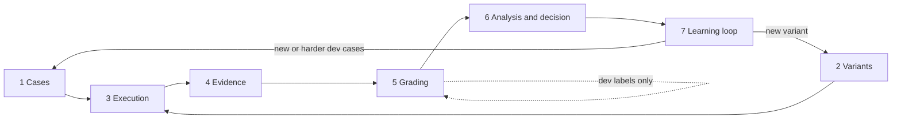
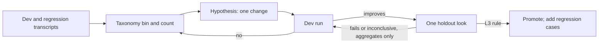

# Workflow Evals Strategy

Status: working specification, revised 2026-10-19 against the evals review. It is the specification this package follows for how the lab evaluates workflows. It is not a confirmed authority while the matching bullets in [RUN/DECISIONS.md](../RUN/DECISIONS.md) remain [PROPOSED]. It supersedes §6 "Workflow Evals Suite" of [PRODUCT-STRATEGY.md](PRODUCT-STRATEGY.md) as that proposal, including that document's Claude-Code-first runtime emphasis. Proposal/PPTX product detail there is parked, not deleted. Assumptions are in [RISKIEST-ASSUMPTIONS.md](RISKIEST-ASSUMPTIONS.md) (20 rows). Sources are in [EVIDENCE-BASE.md](EVIDENCE-BASE.md).

Runtime stance (user decision, 2026-10-19): **OMP + Tern centric**. Claude Code is the execution runtime only if OMP or Tern becomes a blocker. The corporate laptop uses the same stance: OMP + Tern, Claude models only (section 10).

## 0. Summary

A workflow eval answers one question: **for a defined class of real jobs, does workflow variant B produce accepted deliverables more reliably, at higher quality or at lower cost than variant A, and why?**

Phases 0–3 answer a narrower question: autonomous-segment quality and token cost. Live human checkpoints are not in those trials. Human effort and acceptance are a later sampled metric (assumption M4).

The lab is a small, file-based experiment system:

- **Variants** are skills, agents and model-role choices.
- **OMP print mode** runs them on **versioned cases**, in a trial directory outside any repo.
- A **four-tier grader stack** scores the artifacts. Judges are calibrated against human labels drawn only from dev cases.
- Results are analysed as **paired, pre-registered comparisons**, recorded in an **experiment ledger**, and inspected in **Tern** (read-only).

The order is deliberate: first prove the lab can *measure*, then prove a workflow is *better*. Credibility comes from the grader and the protocol, not from the orchestration.

## 1. Scope: what a workflow eval is

| Evaluation type | What varies | What is held fixed | Question | Example here |
|---|---|---|---|---|
| Model eval | Model | Prompt and harness | Which model is more capable? | `omp bench` and `omp if-bench` |
| Harness eval | Agent runtime | Model and task | Which agent tooling helps the model most? | OMP vs Claude Code on the same tasks |
| **Workflow eval** | **The process**: decomposition, instructions (skills), roles and model routing, tools, verification gates, budgets. Live human checkpoints are not a Phase 0–3 factor | Job class, cases, graders, and (unless it is the factor) the role map and runtime | Does this way of working deliver more accepted autonomous output per unit of cost? Effort is sampled later (M4) | Single agent vs a skill variant on text-only proposal briefs |

A **workflow variant** is a content-hashed bundle: skill files, custom agent definitions, bundled agents unpacked into the variant (`omp agents unpack --dir variants/<id>/agents --json`), the prompt entry point, model-role bindings, a hashed `--config` overlay, budgets and gates. Two runs belong to the same variant only if that hash and the runtime profile match.

**"Push the models as hard as possible"** splits into two objectives that are always reported separately:

1. **Frontier**: the best quality reachable on a case at any reasonable cost. This is a capability question.
2. **Efficiency**: the quality–cost frontier. This is the shipping question. Human effort is not on this frontier until M4.

A variant that wins on quality by spending an order of magnitude more tokens has not answered the efficiency question ([Anthropic multi-agent research system](https://www.anthropic.com/engineering/multi-agent-research-system); [Kapoor et al.](https://arxiv.org/abs/2407.01502)).

Out of scope: production traffic monitoring, building a new agent harness, vendor eval platforms as the system of record, and any GPT or other-provider dependency.

## 2. Vocabulary

Adopted from [Anthropic, *Demystifying evals for AI agents*](https://www.anthropic.com/engineering/demystifying-evals-for-ai-agents):

| Term | Meaning in this lab |
|---|---|
| Case (task) | One job: a brief, inputs and acceptance spec. It is the **unit of analysis**. |
| Trial | One execution of one variant on one case. Repeats, not new data points. |
| Transcript | Session export, final message, produced files. Diagnosis uses dev and regression transcripts only. |
| Outcome | Artifacts and end state. "The agent said it is done" is not an outcome. |
| Grader | A versioned check: deterministic, judge, human or downstream. |
| Suite | **dev** (tunable), **holdout** (sealed), **regression** (previously solved). Split by cluster. |
| Variant / baseline | The workflow under test, and the strong simple comparator it must beat. |
| Role map | The binding of default, subagent/task/scout and slow seats: family, thinking level, context cap. Comparisons are valid only inside one map. |
| Experiment | A pre-registered comparison, ending in a recorded decision. |
| Ledger | Append-only: pre-registration, results, decision, links. |

## 3. Operating rules

These are the non-negotiables. Sources are in the [evidence base](EVIDENCE-BASE.md).

1. **Error analysis before metrics.** No aggregate score until a human has open-coded around 30 **dev** transcripts and grouped them into a failure taxonomy. Those bins become the first graders ([Husain](https://hamel.dev/blog/posts/llm-judge/index.html); [EvalGen](https://arxiv.org/abs/2404.12272)).
2. **Grade outcomes, not paths.** The headline score comes from artifacts and end state. Trajectory tags explain the first failure; they never decide the winner. A valid artifact that fails a brittle check is a grader bug ([SWE-bench Verified](https://openai.com/index/introducing-swe-bench-verified/); [τ-bench](https://arxiv.org/abs/2406.12045)).
3. **Always include a strong baseline.** One capable agent, same information, an explicit shared `--tools` list that does not include `task`, and the same budget (`--max-time` plus a token band). It is never a straw man and it is not defined as `--no-skills`. Extra agents must beat it at reported cost ([Anthropic, *Building effective agents*](https://www.anthropic.com/engineering/building-effective-agents); [Cognition](https://cognition.ai/blog/dont-build-multi-agents)).
4. **Paired comparisons with intervals.** Both arms run on the same cases. Average trials to a case mean, then cases to a cluster mean, and run a paired t-test on the cluster differences with G−1 degrees of freedom. Report G. An interval that covers zero is **inconclusive**, not a tie and not a match. "Better" requires the interval to exclude zero. "Matches" requires the whole interval to lie inside a pre-registered equivalence margin ([Miller 2024](https://arxiv.org/abs/2411.00640)).
5. **Pre-register the decision.** Before a paid run, write the primary metric, the minimum effect worth acting on, the equivalence margin, guardrail margins, trials per case, maximum N, whether one interim look is allowed, the role map, and what will *not* be claimed. Anything else is exploratory. No post-hoc extension.
6. **Use pass^k as a reliability column, not the default primary.** Report the probability that all k trials succeed. With exactly 3 trials, pass^3 is a per-case all-pass indicator and is too noisy to be primary. Use pass@k only when a human or verifier really picks among k outputs. Do not lower temperature to make the numbers look stable ([Miller](https://arxiv.org/abs/2411.00640); pass^k: [τ-bench](https://arxiv.org/abs/2406.12045); pass@k: [Chen et al.](https://arxiv.org/abs/2107.03374)).
7. **No judge in the score until it is calibrated.** Human pass/fail labels come only from dev cases, from every arm that will be judged, in a train/dev/test split. The test split is touched once per frozen prompt. Report per-arm TPR and TNR with counts and Wilson 95% intervals. Swap positions in pairwise judgments and control for length. Pin the judge to a role on the same role map (corporate: slow seat or default), not to another provider. Allow "unknown" ([Zheng et al.](https://arxiv.org/abs/2306.05685); [Panickssery et al.](https://arxiv.org/abs/2404.13076)).
8. **Seal a holdout.** Skills are never tuned on the holdout. A holdout result reports only the pre-registered decision and aggregates. Nobody reads or open-codes holdout transcripts. Budget: one confirmatory look per pre-registered comparison. A further look is a new pre-registration. Any case whose transcript is inspected rotates into dev and is replaced. Public benchmarks are not evidence about this workflow ([GSM1k](https://arxiv.org/abs/2405.00332); [SWE-bench Verified retirement](https://openai.com/index/why-we-no-longer-evaluate-swe-bench-verified/)).
9. **Version everything that defines a result.** A result line names case-set hash, rubric version, grader version, variant hash (including unpacked agents), config-overlay hash, OMP version, approval mode, and the role map (model per role, thinking level, context cap). One "observed model" is not enough. Editing the rubric after seeing scores invalidates the comparison. If `omp --version` changes between trials, abort or flag the experiment.
10. **Cost, latency, turns and, later, sampled human minutes are columns.** Unknown is unknown, never zero. Read every surprising **dev or regression** trial before acting on its number. Do not read a surprising holdout trial; rotate the case out if you must.

## 4. The lab model: seven layers

Inputs → treatment → procedure → observation → measurement → inference → adaptation. Layers talk only through files. **Layers 3 and 5 run OMP** (trials and judge calls). Layer 4 may call `omp --export` and `omp stats` as documented reads; it does not run the variant. The other layers do not invoke OMP. A runtime switch rewrites layer 3 and re-calibrates layer 5 judges; it does not transfer judge calibration.

| # | Layer | Question | File contract (planned layout) | Touches OMP? |
|---|---|---|---|---|
| 1 | Cases | What jobs, and what counts as done? | `suites/<domain>/{dev,holdout,regression}/<case-id>/` with `brief.md`, `inputs/`, `acceptance.md`, optional reference. Suites split by cluster | No |
| 2 | Variants | How is the work done? | `variants/<variant-id>/` with skills, `agents/` (unpacked bundle), entry prompt and `variant.md` (roles, `--tools`, budgets, gates, hypothesis); content hash | Definition only. OMP skills are `SKILL.md` files. External Agent Skills and Claude Code skills docs are not verified in the research notes |
| 3 | Execution | Run variant × case × trial in isolation | Wrapper: trial directory **outside any repo**, `omp -p` with `--profile`, `--session-dir <trial>/session`, `--tools`, `--approval-mode`, `--thinking`, `--max-time`, `--config` overlay, `--no-prewalk`, `--no-title` | **Yes** |
| 4 | Evidence | What actually happened? | `runs/<exp-id>/<case-id>/<trial>/` with `out/`, final message, `manifest.json`, then `omp --export` of the session file written under `--session-dir`. Export is not a flag on the trial run | Allow-listed session fields only (model, provider, usage). Missing becomes unknown, never an error. Not event-stream scoring |
| 5 | Grading | How good is the outcome? | `graders/<grader-id>@<version>/`; `grades.jsonl`; labels at `labels/<criterion>@<rubric>.jsonl` (rater id, arm, split, critique) | **Yes**, when a judge is an `omp -p` grader-skill run |
| 6 | Analysis | Is B better than A, and by how much? | `ledger/<exp-id>.md`: pre-registration, per-case table, cluster-level paired estimate, interval, pass^k column, cost, decision | No |
| 7 | Learning | What should change next? | `taxonomy.md` from dev and regression only; hypothesis queue; promotion log. Sampled human log: `logs/t3.jsonl` | No |

Two cross-cutting concerns sit outside the seven layers:

- **Inspection (Tern).** Read-only views over layers 4–7 (section 11). Tern does not run trials.
- **Governance.** Data class per suite, budget per experiment, role map id. Run outputs stay outside tracked source and outside any repo. Synthetic outputs may be kept as fixtures; they are not business evidence.

This layout is *planned*; Phase 0 creates it. Do not pre-create empty folders for later domains.

## 5. Metrics

One **primary** metric per pre-registration: the paired difference of per-case mean pass rates (clustered as in rule 4). The others are **guardrails**. A guardrail "holds" only under a non-inferiority check: the lower bound of its paired difference is above −margin. Failing to detect a regression is not "no regression".

Categories are disjoint. A missing or invalid artifact is a **control** failure, not an outcome-quality score. Outcome quality is computed only on artifacts that exist and parse.

| Category | Metric | Grain | Source |
|---|---|---|---|
| Outcome quality | Pass rate on binary rubric criteria; blind pairwise win rate | Case (mean of trials) | T1–T2, valid artifacts only |
| Reliability | pass^k; per-case variance. Column, not the default primary | Case | Repeated trials |
| Cost | Reported tokens by scope, cost estimate, wall-clock, turns, subagent count | Trial | Manifest |
| Human effort | Review minutes, interventions, rejected stages. Not a per-trial column in Phases 0–3 | Sampled output | `logs/t3.jsonl` (M4, Phase 4) |
| Downstream acceptance | Rate of deliverables accepted without a major rewrite | Real job | `logs/t3.jsonl` (T3, Phase 4) |
| Control | Missing or invalid artifacts, budget / time / context-cap breaches, unapproved actions, skill required but not loaded | Trial | T0 and manifest |

**Trial-level pass** (the bit pass^k uses): every primary criterion passes, the artifact is present and valid, and no primary criterion is "unknown". Unknown is not a pass and not a fail for TPR/TNR; it is its own rate. If that rate exceeds its pre-registered margin, the criterion is human-graded.

The unbiased per-case pass^k estimate from n trials with c successes is C(c,k)/C(n,k) ([τ-bench](https://arxiv.org/abs/2406.12045)). Average it over cases.

**Difficulty axis.** Tag each case with estimated skilled-human time, including context gathering. That tag is not a horizon estimate. The human-time band at which pass^1 crosses 50% and 80% is [METR's method](https://metr.org/blog/2025-03-19-measuring-ai-ability-to-complete-long-tasks/), and it cannot be estimated on 10–20 cases. Do not report a horizon until the set spans several time bands. Their doubling forecast is not used.

## 6. Grading stack

Four tiers, cheapest first. A trial can fail at any tier. GDPval, PPTEval and VBench each needed more than one signal. SWE-bench Verified is graded by tests alone; its human annotation was dataset curation (items removed), which is why cases are audited before use ([frontier notes](research/workflow-frontier.md) §5).

| Tier | What | Properties | Validity requirement |
|---|---|---|---|
| T0 Deterministic | Files exist and open, schema valid, numbers match the source pack | Fast, reproducible, brittle | A reference or human solution passes every T0 check. Missing or invalid artifacts are control failures, not T0 quality scores |
| T1 Rubric | Binary criteria from error analysis, at most 5 in Phase 1, graded by a human or a calibrated judge | Flexible once calibrated | Per-arm TPR and TNR on an untouched test split, with counts and Wilson intervals; position-swap consistency for pairwise use |
| T2 Expert preference | Blind pairwise comparison of whole deliverables | Holistic; expensive | Blinding, randomised order, ties allowed, rater id recorded, plus a "guess the arm" check when the rater is the author |
| T3 Downstream | Accepted without major rewrite, edit minutes, sent or published | Closest to value; slow | Logged on real jobs in `logs/t3.jsonl`. Validates T0–T2. Does not tune. Not collected in Phases 0–3 |

Judge protocol (T1):

1. Labels come only from **dev-suite** cases, from **every arm** that will be judged. Seeded failures are allowed, marked, and still tied to a dev case. Holdout cases are never labeled for calibration. At most 5 criteria in Phase 1.
2. Each criterion needs ≥ 20 pass and ≥ 20 fail labels before a calibration claim. Split each criterion's labels into **train** (few-shot), **dev** (prompt edits) and **test** (touched once per frozen prompt). Two splits are not enough: editing on the only held-out set unseals it.
3. The judge prompt grades **one criterion per call** and may answer "unknown". Unknown is excluded from TPR/TNR and reported as a rate.
4. Freeze the prompt. Report test-split TPR and TNR **per arm**, with confusion counts and Wilson 95% intervals. Accuracy alone hides a judge that always says pass. A point bar on a tiny set is not calibration (a true TPR of 0.70 still clears ≥ 8/10 about 38% of the time; 7/8 has a Wilson interval of roughly [0.53, 0.98]).
5. Re-calibrate when the judge role, the rubric, the generator role, or the variant's outputs change. On the corporate profile the judge is the slow seat or the default role. There is no other provider to switch to. Recalibrate when that binding changes.
6. A judge that fails calibration stays diagnostic. Its criterion is human-graded or replaced by a T0 check.

For M1, report positive and negative agreement (or Gwet's AC1) alongside Cohen's κ. κ on a rare-failure criterion can be low despite high raw agreement; do not drop a criterion on κ alone. A delayed self-label measures one rater's consistency, not independent agreement.

In OMP, a judge is a print-mode run of a grader skill with an explicit judge role. `eval`/`judge` exist only as an in-session agent tool, not as a CLI ([capability notes](#11-omp--tern-mapping)).

## 7. Experimental protocol

### Lifecycle of one experiment

1. **Explore** on dev only. No claims. No holdout transcripts.
2. **Pre-register** in `ledger/<exp-id>.md`: hypothesis; arms (always the baseline); suite and case hashes; cluster split; role map; primary metric and minimum effect; equivalence margin; guardrail margins; trials per case; maximum N; at most one interim look and what it may trigger; grader versions; budget (`--max-time` and token band); decision rule; claims not made.
3. **Run.** Same cases, interleaved or randomised, fresh external trial directory, `--session-dir` per trial, same role map unless the map is the factor. Abort or flag if `omp --version` changes mid-experiment.
4. **Grade blind.** Graders do not see arm labels. Human raters see randomised pairs. The solo author records a guess of the arm before unblinding; report guess accuracy. If they can tell the arms apart, blinding failed.
5. **Analyse.** Per-case table first. Average to cluster level. Paired t-interval with G−1 degrees of freedom. Report G. Do not use cluster-robust standard errors at the 3–6 clusters a 10–20 case suite will have; they are too optimistic there. Miller's result still stands: naive per-case standard errors can be about 3× too small when cases share a template ([Miller](https://arxiv.org/abs/2411.00640)). Also report pass^k, cost, and the sign count (descriptive, not a test).
6. **Decide** only under the pre-registered rule: promote, reject, or inconclusive. The single interim look may only continue to maximum N or stop. It may not add cases, change the metric, or launch another look.
7. **Record** the decision and the next hypothesis. Failed and inconclusive experiments stay in the ledger.

### Design defaults

- **One factor at a time** when feasible. Named in the pre-registration.
- **Trials per case: 3** by default, for a reliability column and a case mean. The primary is the paired difference of those means, not pass^3. Adding trials stops helping once within-case noise is small relative to between-case spread ([Miller](https://arxiv.org/abs/2411.00640) §3).
- **Phase 1 cases are fixed:** 12 dev + 8 holdout, text-only proposal storylines, split by cluster, at most 5 binary criteria. Baseline × 3 trials on dev is 36 outputs. See section 8. A 10–20 case suite can see large effects only. The notes' wording is that a prompt tweak *might* move success from about 30% to 80% on around 20 queries ([eval-science notes](research/eval-science.md)); that is not a reported guarantee.
- **Scale check, planned default.** One unpaired pass/fail mean on 10 cases at a 50% pass rate has a standard error of about 16 points, so a 95% interval is about ±31 points. The same formula at n=25 is about ±20 points and is not the plan.
- **A/A runs** (the same variant twice) on the **same suite, metric and graders as V1** estimate trial-to-trial noise only. Between-case variance ω² is zero by construction in an A/A, so the minimum detectable effect is **not** computed from A/A. It comes from a pre-registered ω² (planning range 1/9 to 1/4) or from a dev pilot.

### Detectable paired effect

Planning illustration from Miller's sample-size formula, inverted, at 80% power and 5% two-sided, with residual trial noise σ = 0. Trial noise only makes the detectable effect larger. These are not measured lab variances. About 39 cases is what a 15-point effect needs at ω² = 1/9 under those assumptions.

| Cases n | Detectable \|Δ\| at ω² = 1/9 | Detectable \|Δ\| at ω² = 1/4 |
|---|---|---|
| 10 | 30 points | 44 points |
| 20 | 21 points | 31 points |
| 40 | 15 points | 22 points |

An underpowered interval is **inconclusive**. It does not "match" the baseline. "Matches" requires the whole interval inside the equivalence margin, which this table says will usually be unavailable at n = 10 or 20.

### Evidence levels

Claims use these labels and nothing stronger. Synthetic-only results are **L1 at most**, even if the interval excludes zero.

| Level | Requirements | Allowed claim |
|---|---|---|
| L0 Anecdote | Single trial or uncontrolled run | "Worked once" |
| L1 Exploratory | Dev cases, rubric not frozen, or synthetic-only | "Looks promising on dev; hypothesis for testing" |
| L2 Indicative | Pre-registered, frozen graders, paired, not synthetic-only | "Δ [a, b]". Add "better" only if the interval excludes zero. If it covers zero: "inconclusive" |
| L3 Confirmed | L2 on the sealed holdout with calibrated graders; interval excludes zero on the primary; each guardrail's lower bound above −margin; one pre-registered holdout look | "B beats A for this job class at this cost" |
| L4 Validated | L3 plus per-output agreement with T3, interval reported | "B delivers more accepted work in practice" |

G1's dev-versus-holdout magnitude ratio is a reported diagnostic. It is not a second promotion rule.

## 8. Cases and suites

Phase 1 is **one domain**: text-only proposal storylines, reusing the existing brief format (`workflows/prompts/storyline.md`, with `examples/synthetic-brief.json` as a format example, not as evidence). No second domain runs in parallel. The software or document mini-suite is optional and is not the S1 suite. Phase 2 is the same domain. The software factory is Phase 5.

- **Sources, in order:** real jobs (sanitised, private); recreations with synthetic details; synthetic cases; public benchmarks (orientation only).
- **Case card** (`acceptance.md`): objective, inputs, hard constraints, T0 checks, applicable T1 criteria, reference if any, estimated human time (tag only), data class, cluster tag (template or client family).
- **Counts.** 12 dev + 8 holdout. A cluster sits entirely in one suite. If that would break the count, move the whole cluster and backfill from the same domain until the counts are met. Regression starts empty and receives cases only on promotion.
- **Audit before use.** A human or reference solution must pass the case's graders. Remove or fix cases whose checks reject valid work: SWE-bench Verified removed 68.3% of sampled original items for this kind of reason ([OpenAI](https://openai.com/index/introducing-swe-bench-verified/)). A 0% pass rate over many trials means suspect the case first.
- **Balanced cases.** Include cases where the right behaviour is *not* to act, so a variant cannot win by over-triggering.
- **Labels and logs.** `labels/<criterion>@<rubric>.jsonl` holds rater id, case id, arm, output hash, split (`train`, `dev`, `test`), pass/fail, critique, and a seeded flag. Dev cases only. `logs/t3.jsonl` holds the sampled human and T3 log (Phase 4).
- **Supply.** Authoring and auditing is assumption K1. If it does not fit, narrow the job class. Do not open another domain.
- **Saturation.** Capability cases that pass reliably graduate to regression. Harder cases are added on dev, not by opening the holdout.

## 9. Learning loop

The fails edge carries the pre-registered decision and aggregates. It does not carry holdout transcripts, quotes, or open coding. An inspected holdout case rotates into dev.

- **Taxonomy starter labels:** specification, inter-agent misalignment and verification ([MAST](https://arxiv.org/abs/2503.13657)), extended by the lab's own open coding of dev traces. Diagnostic, not scores. The notes' claim is that a verifier is not sufficient, not that verification should be skipped.
- **One meaningful change per candidate.**
- **Ablation is a simplicity prior, not a deletion machine.** At 10–20 cases the smallest detectable effects are about 20–30 points, so "lift within noise" is the usual result and is **not** evidence of no lift. Ablate only costly components (extra agent, extra review gate, extra model hop). Bundle those ablations under one pre-registered comparison and one holdout look. Delete only when the lift interval lies inside the equivalence margin, or when the component fails a pre-registered cost guardrail. Do not spend a holdout look per component.
- **Automated optimisers later.** [GEPA](https://arxiv.org/abs/2507.19457), [DSPy](https://arxiv.org/abs/2310.03714) and similar tools are allowed only after the holdout is sealed and the judge is calibrated. Report train and holdout separately. A human audit sample stays outside the optimiser's view ([Gao et al.](https://arxiv.org/abs/2210.10760)).

## 10. Durability against OMP and model updates

| Build on (stable) | Avoid (fragile) |
|---|---|
| Markdown skills and agent definitions | Parsing OMP's JSON event stream or session JSONL for scores |
| Cases, rubrics, graders and ledger as plain files | Extension or hook APIs for core lab function |
| Documented CLI flags listed in section 11, pinned by a hashed `--config` overlay | Hard-coded model ids inside skills; model-specific prompt hacks |
| Artifacts written to `out/` under a declared contract | Fixed stage graphs encoding today's model weaknesses |
| Model **roles** (`--smol`, `--slow`, `--plan`, explicit `--model`) recorded as a map | Vendor eval platforms as the system of record; any non-Claude provider on the corporate profile |

### Corporate role profile

User-provided fact, 2026-10-19. Primary target of the canary, of profile isolation, and of any CI check. Same OMP and Tern versions as the help check in section 11. **Claude models only.** No GPT or other-provider dependency. Families and seats, not invented provider model ids (record the observed id from the session file; if absent, unknown):

| Role | Family | Thinking | Context cap |
|---|---|---|---|
| default | Claude Sonnet | high | 200k |
| task and scout subagents | Claude Haiku | pin and record (not specified by the fact) | 100k |
| slow seat | Claude Opus 5.5 | high | 200k |

Implications:

- The manifest records the model, thinking level and context cap **per role** (default, subagent/task/scout, slow), plus approval mode and the config-overlay hash. Not one observed model.
- A variant that delegates runs task and scout seats on Haiku at a 100k cap. Context-budget failures are a real failure mode and a control outcome, not a quality score.
- A comparison is valid only inside one role map. A home-lab result on any other map is not evidence for this profile. Re-run the baseline on the corporate laptop before citing it there.
- Judges are pinned to the slow seat or the default role on this map and recalibrated when the binding changes.

### Mechanisms

- **Pin and record.** Every manifest records OMP version, the role map, variant hash, grader versions, approval mode and config hash. An OMP version change between trials aborts or flags the experiment.
- **Canary on update.** After an OMP or model-role update, run the regression suite unchanged before anything else. The corporate profile is the primary canary target. A harness failure is fixed in layer 3 only. A score shift is investigated, and D3's anchor set is re-graded, before new experiments.
- **Re-baseline inside the map.** On a model or role-map change, re-run baseline vs best variant on that map and track scaffold lift. Do not import a home-lab delta from a different map.
- **Keep the harness small enough to rewrite in an afternoon.** A wrapper and an analysis script. The existing 1,776-line runner is the counterexample: strict OMP event parsing fails by design on new event types.
- **Claude Code fallback.** Layers 1, 2, 6 and 7 are runtime-independent. Layer 4's file contract is too; the session-file reader is not. Switching runtime rewrites the layer 3 wrapper, re-calibrates layer 5 judges, and re-runs the canary and the baseline. Judge calibration does not survive the switch.

## 11. OMP + Tern mapping

Verification key: **local** = observed on this machine from help only (OMP 18.12.2, Tern 0.9.4; no model runs); **docs** = not help-checked, smoke-test in Phase 0. "Includes subagents" is not a help claim.

| Need | OMP / Tern feature | Status |
|---|---|---|
| Non-interactive trial | `omp -p`; `--cwd`; `--max-time`; `--session-dir` (session storage for that trial) | local |
| Controlled environment | `--profile` (auth, sessions, settings, caches — not the work tree); `--no-rules`, `--no-extensions`, `--skills`, `--tools`, `--approval-mode` (always-ask\|write\|yolo), `--auto-approve`, repeatable `--config` overlay | local |
| Unattended approvals | Set `--approval-mode` explicitly. `always-ask` fails the no-interaction bar. Record the mode. Profile defaults are not a control | local |
| Variant model routing | `--model`, `--smol`, `--slow`, `--plan`; `--thinking` (off\|minimal\|low\|medium\|high\|xhigh\|max\|auto) | local flags; agent frontmatter not re-checked |
| Switches that change the treatment | `--prewalk` / `--no-prewalk` (can hop to a cheaper model mid-run); `--advisor`; `--no-title` (title generation is an extra call). Pin them in the overlay and on the CLI. Off unless they are the factor | local |
| Variant instructions | Skills (`SKILL.md`); entry prompt names the skill under test; `--append-system-prompt`; `@file` | local |
| Bundled agents inside the hash | `omp agents unpack --dir variants/<id>/agents --json` | local |
| Transcript for humans | After the trial, `omp --export <session file>` (existing file in, HTML out, then exit). Whether HTML includes subagents is **unverified**. `omp render --plain` | local |
| Shareable evidence | `omp anonymize` (redacted copy; help text says subagent contents are redacted and metadata kept) | local |
| Usage and cost | `omp stats` has only `--json`, `--summary`, `--port`, `--host`: no session or profile filter. Per-trial attribution is an allow-list read of model, provider and usage from the session file (assumption C2) | local (aggregate only) |
| Judge execution | Grader skill via `omp -p` with an explicit judge role. In-session `eval`/`judge` are not a CLI | docs |
| Inspection | `tern open` for files; Markdown rendering. `tern new` / `run` / `capture` / `events` exist and are **not** the trial path | local |
| Dashboards | Plugin blocks; Mermaid in Markdown | docs |
| Spatial workflow view | Whiteboard reads and edits exist; no change-event API (historical, Tern 0.9.2) | historical |

`omp agents` manages bundled task agents (`unpack`, `--dir`, `--json`). It is not a stats command.

## 12. Visualisation and graphs

- **Loops for generation, graphs for plumbing.** A variant is a loop steered by skills and gates. Deterministic graphs belong in graders and QC, and in external integrations that call `omp -p`. No study shows graph workflows survive model upgrades better ([frontier notes](research/workflow-frontier.md) §4).
- **Visualise evidence before definitions.** Ledger and scoreboards as Markdown in Tern; transcripts via `--export` of the session file; Mermaid generated from `variant.md`; a read-only whiteboard projection only after that.
- **n8n-style editing is not on the roadmap** unless P1 passes. The Apply/Validate/Save contract in [PRODUCT-STRATEGY.md](PRODUCT-STRATEGY.md) §4 remains the safety design if that happens.

## 13. Domain extension: proposals → software factory → video

The layer **contracts** do not change across domains. A new domain may add cases (layer 1) and graders (layer 5) only. Layers 2, 3, 4, 6 and 7 stay put (G3). Phase 1 and Phase 2 execute **text-only proposal storylines** only. The rows below are the contract check, not a parallel build.

| Layer | Proposals (Phase 1–2) | Software factory (Phase 5) | Video (specified, not scheduled) |
|---|---|---|---|
| Cases | Text-only briefs, existing brief format | Specs plus a repo fixture; scenarios stored outside the repo the agent can edit ([StrongDM](https://factory.strongdm.ai/)) | Briefs, scripts, asset packs, delivery spec |
| T0 | Required sections, numbers match source | Hidden fail-to-pass and pass-to-pass tests, build, lint | Duration, resolution, codec; loudness per [ITU-R BS.1770](https://www.itu.int/rec/R-REC-BS.1770/en); caption error; [VMAF](https://github.com/Netflix/vmaf) only with a reference |
| T1 | At most 5 binary criteria on our briefs | Scenario satisfaction | Per-dimension criteria in the style of [VBench](https://arxiv.org/abs/2311.17982) |
| T2 | Blind pairwise vs an accepted human text, when one exists | Review preference on the diff | Pairwise preference per dimension |
| T3 | Accepted without major rewrite; edit minutes (sampled, Phase 4) | Merged and stays green | Approved, revision count, delivery rejection |

GDPval grades one-shot deliverables. The outcome this lab can add — a workflow run including revisions, and whether a human accepted the last draft — is not in any of these papers ([frontier notes](research/workflow-frontier.md) §5). Phases 0–3 grade the **autonomous segment**, including model revisions inside the run. The human decision is M4, not part of the unattended trial.

The earlier inference that the instrument should be calibrated on a software mini-suite, with proposal grading in parallel, is withdrawn. Case supply is the binding constraint (K1). Proposal grading validity is Phase 1, on the pinned set, not a second workstream.

## 14. Roadmap

Each phase ends when its assumptions pass or are killed. Phases are order, not execution authority. Paid runs need a budgeted pre-registration. Phase 0 can start from the checks written here. Phase 1 cannot start until K1, the label file and the pinned counts are in the pre-registration.

| Phase | Deliverable | Proves | Exit criterion |
|---|---|---|---|
| 0 Instrument | Skeleton, case card, `variant.md`, wrapper, manifest (role map, approval mode, config hash, skill-loaded), ledger template. Baseline vs one skill variant on two synthetic cases, trial dirs outside any repo | P2, C1, C2 | 4/4 unattended; artifacts in `out/`; skill arm loaded; manifest complete; unknowns explicit; canary markers absent |
| 1 Calibrate | One domain: 12 dev + 8 holdout proposal storylines, cluster-split, ≤ 5 criteria. A/A on that suite. Error analysis, rubric v1, three-split judge calibration. Freeze the D3 anchor set when the judge exists. Mini-suite not required | K1, S1, E1, M1, M2, D3 (anchor) | Cases audited; MDE taken from the §7 table or a dev pilot; agreement reported; judge TPR/TNR per arm with Wilson intervals, or human fallback; anchor set frozen |
| 2 First comparison | Same domain. Pre-registered baseline vs skill variant on dev, then one holdout look | V1 | L2 or an explicit inconclusive on dev, then the holdout decision. Not a synthetic-only L2 |
| 3 Improve | Three learning-loop cycles on dev; one bundled push-harder sweep. Holdout only under the one-look budget | V2, V3, G1 | Holdout decision and aggregates recorded; no holdout open-coding |
| 4 Validate | Per-output T3 log; G2 against sanitised real cases; sampled human-effort log; canary and anchor re-grade on the next update | M3, M4, D1, D2, D3, G2 | Association interval reported or the claim withheld; update survived or breakage localised to layer 3; judges re-calibrated if the role changed |
| 5 Extend | Software-factory suite; Tern views beyond Markdown only if P1's Phase 2 notes justify them | G3, P1 | No contract change in layers 2, 3, 4, 6, 7. New cases and graders only |

## 15. Non-goals

- No graph editor, n8n clone or workflow DSL before P1 evidence.
- No optimiser before a sealed holdout and a calibrated judge.
- No parsing of OMP event streams for scores, and no `tern capture` scraping or RPC-mode fallback to paper over a print-mode failure.
- No vendor eval platform as the system of record. [Inspect AI](https://inspect.aisi.org.uk/) and [promptfoo](https://www.promptfoo.dev/docs/intro/) may write into the lab's files; they do not replace them.
- No business-quality claim from synthetic cases. Synthetic-only results stay L1.
- No PPTX or business-development build until Phase 2 has an L2 result on non-synthetic cases (real or recreated). An L2 on synthetic cases does not unlock that work, and G2 is still untested until Phase 4.
- No second domain in Phase 1.
- No GPT or other-provider model or judge.
- No live human-in-the-loop trial in Phases 0–3.

## 16. Existing assets

- `scripts/run_workflow.py`, its tests and `workflows/proposal-storyline.workflow.json` are a **proposed freeze** (see [RUN/DECISIONS.md](../RUN/DECISIONS.md)): kept, not extended, not deleted without authorization. Reusable lessons for the layer 4 manifest: receipt fields; unknown is not zero; no silent fallback; failures stay in the denominator.
- Its design — tools, skills and rules disabled, event stream parsed strictly — is what this specification avoids.
- [PRODUCT-STRATEGY.md](PRODUCT-STRATEGY.md) is parked; its banner lists the sections this specification supersedes. §5, the §8 policy checks and the §4 Tern safety contract remain inputs, not the runtime plan: §8's Claude-Code-without-OMP corporate path is superseded by the corporate role profile in section 10.
